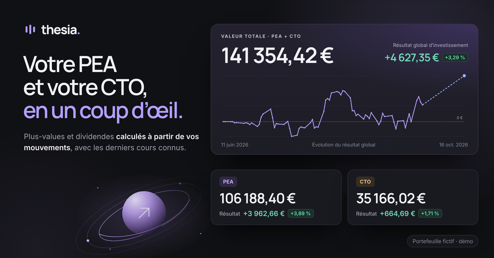
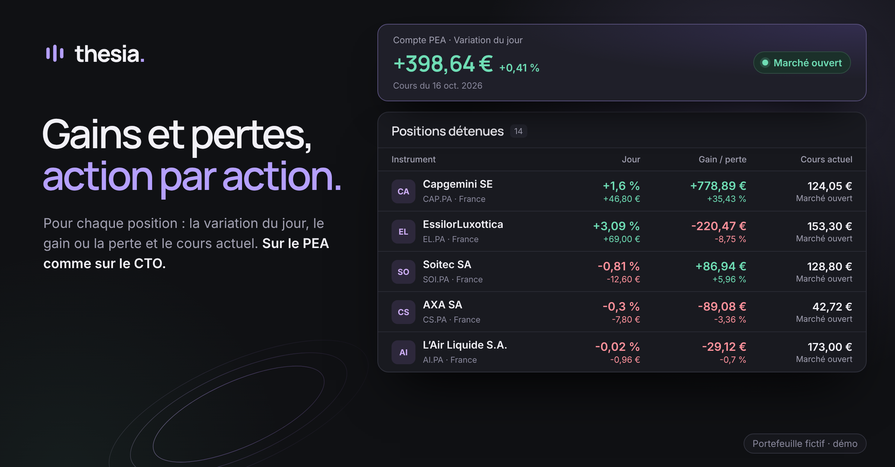
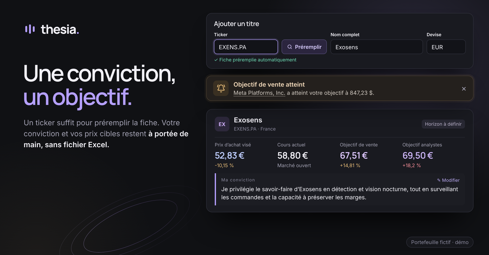

# Thesia

### Vos investissements, avec du recul.

PEA et CTO réunis dans une seule vue, avec des résultats calculés à partir de vos mouvements et une liste de suivi pour vos convictions et vos objectifs.

**[Voir l’accueil de Thesia →](https://thesia.henriteinturier.com)** · [Architecture](ARCHITECTURE.md)

## Au quotidien

<table>
<tr>
<td width="50%" valign="top">

<h3>Suivre chaque position</h3>

Variation du jour, gain ou perte et cours actuel de chaque action, sur le PEA comme sur le CTO.

</td>
<td width="50%" valign="top">

<h3>Garder ses convictions à portée de main</h3>

Un ticker suffit pour préremplir la fiche. Conviction, prix d’achat visé et objectif de vente restent au même endroit, avec une alerte quand l’objectif est atteint.

</td>
</tr>
</table>

**Et aussi :** résultat décomposé en gains latents, gains réalisés et dividendes, historique des dépôts, achats, ventes et dividendes, thème clair ou sombre.

Visuels réalisés à partir de l’application et de son espace de démonstration. Tous les montants, titres et notes présentés sont des données de démonstration.

---

Conçu et développé par **[Henri Teinturier](https://github.com/HenriTeinturier)** pour suivre ses investissements personnels.

**React · TypeScript · TanStack Start · PostgreSQL · Prisma**

Accès privé · Code source privé

[Voir Thesia →](https://thesia.henriteinturier.com) · [Les autres projets](https://github.com/HenriTeinturier#des-applications-pour-simplifier-le-quotidien)
