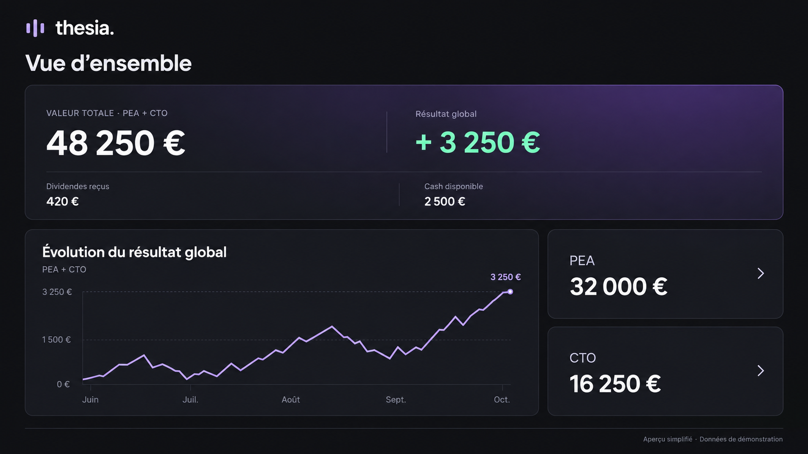
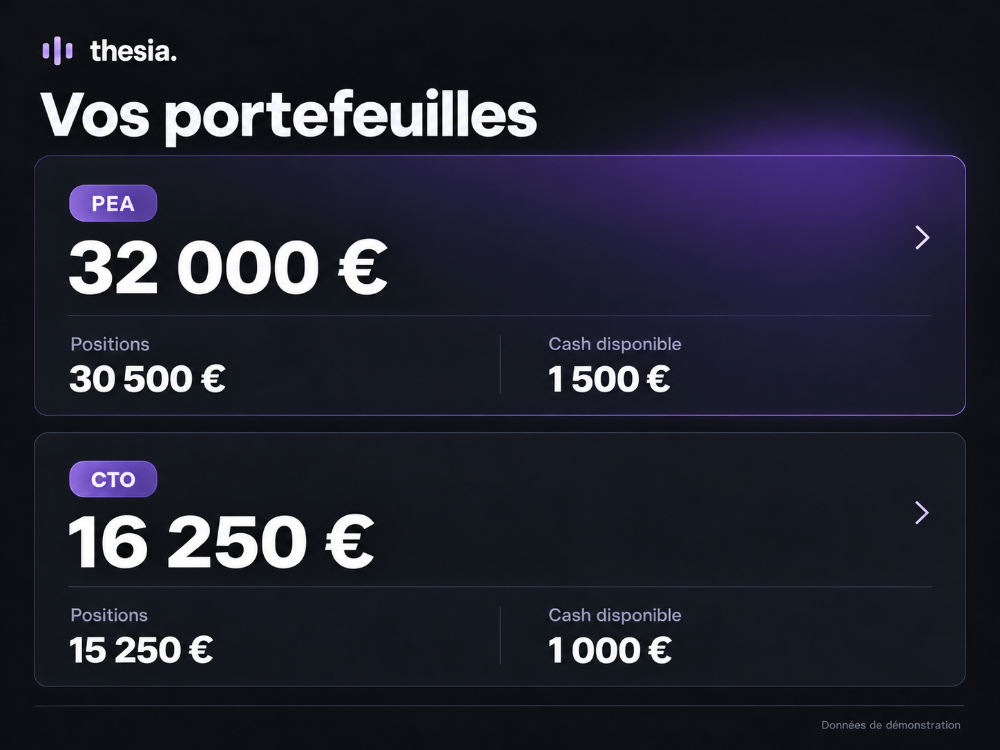
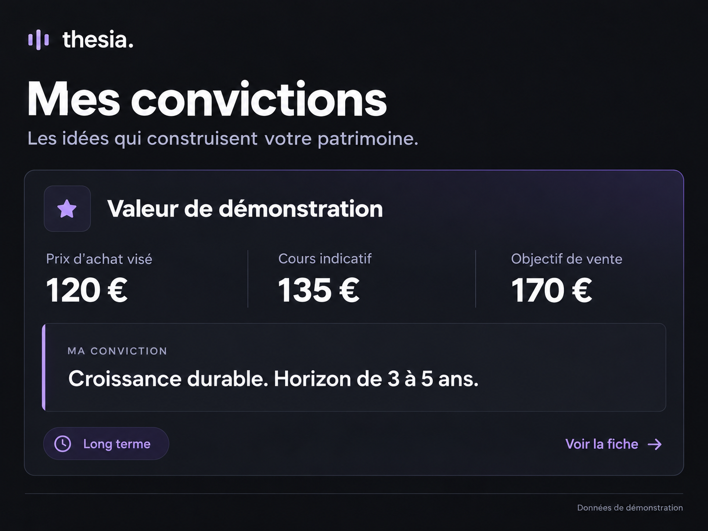
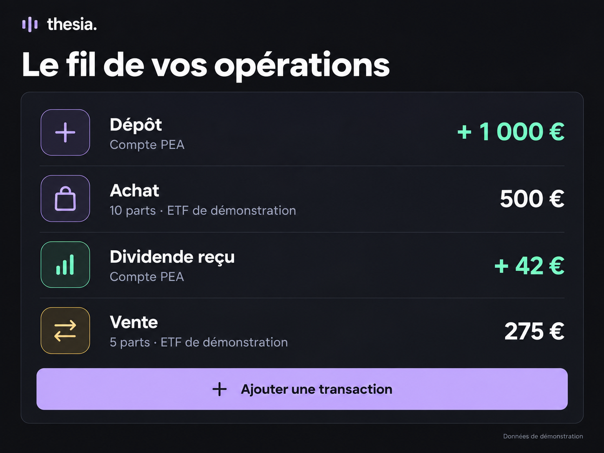

# Thesia

### Vos investissements, avec du recul.

PEA, CTO, résultats et convictions : une vue claire pour suivre votre portefeuille et retrouver le fil de vos décisions.

**[Voir l’accueil de Thesia →](https://thesia.henriteinturier.com)** · [Architecture](ARCHITECTURE.md)

## Du portefeuille aux convictions

<table>
<tr>
<td width="50%" valign="top">

<h3>Tout retrouver au même endroit</h3>

Suivez vos positions et vos liquidités, compte par compte.

</td>
<td width="50%" valign="top">

<h3>Comprendre ses résultats</h3>

Distinguez les gains latents, les gains réalisés et les dividendes reçus.

</td>
</tr>
<tr>
<td width="50%" valign="top">

<h3>Garder le cap</h3>

Notez vos convictions, votre horizon et vos objectifs de prix.

</td>
<td width="50%" valign="top">

<h3>Retrouver chaque mouvement</h3>

Conservez l’historique de vos dépôts, achats, ventes et dividendes.

</td>
</tr>
</table>

Visuels recomposés pour illustrer les usages de Thesia. Tous les montants, titres et notes présentés sont des données de démonstration.

---

Conçu et développé par **[Henri Teinturier](https://github.com/HenriTeinturier)** pour suivre ses investissements personnels.

**React · TypeScript · TanStack Start · PostgreSQL · Prisma**

Accès privé · Code source privé

[Voir Thesia →](https://thesia.henriteinturier.com) · [Les autres projets](https://github.com/HenriTeinturier#des-applications-pour-simplifier-le-quotidien)
